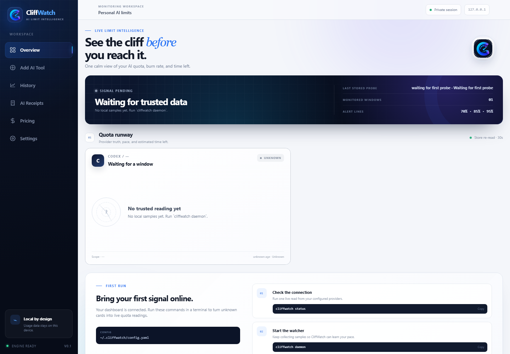

# CliffWatch

[](https://github.com/MennaAhmed2024/cliffwatch/actions/workflows/ci.yml)

CliffWatch is a local-first quota watchdog for AI coding tools. A status scanner tells you where usage is now; CliffWatch also estimates when the remaining quota may run out and sends threshold alerts before that point. It currently monitors Codex CLI and has an experimental OpenRouter adapter, with a terminal interface, a background daemon and a local dashboard.

**Release state:** v0.1.0 is a tested local release candidate. It has not been published to npm. Public `npx cliffwatch status` will work only after publication; this README does not claim a live registry release.

For a short, user-focused walkthrough, read the [CliffWatch User Guide](USER-GUIDE.md).

## Current provider status

| Provider | Status | Setup |
| --- | --- | --- |
| Codex CLI | Working | Install Codex, sign in, then use **Add AI Tool**. CliffWatch discovers versioned desktop installs automatically. |
| OpenRouter | Experimental | Enter `OPENROUTER_API_KEY` through **Add AI Tool**. Authenticated response semantics still require real-fixture verification. |
| Claude Code | Investigated next | Visible but disabled until a trustworthy quota source is verified. No guessed adapter is exposed. |

## Windows quick start

This checkout currently lives at `E:\CliffWatch`. After a restart, open two PowerShell windows.

Dashboard:

```powershell
cd "E:\CliffWatch"
node packages\cli\dist\cli.js dashboard
```

Continuous monitoring:

```powershell
cd "E:\CliffWatch"
node packages\cli\dist\cli.js daemon
```

Open [http://127.0.0.1:3000](http://127.0.0.1:3000). Use **Add AI Tool** to detect, test, preview the first trusted reading, and save a provider. Run a deliberate one-time refresh with:

```powershell
node packages\cli\dist\cli.js sync-now
```

## Run from source

Development requires Node 22.13+ and npm. The distributed CLI supports Node 20+; the dashboard needs Node 20.9+.

```sh
npm ci
npm run build:dashboard
npm exec --workspace=cliffwatch -- cliffwatch status
npm exec --workspace=cliffwatch -- cliffwatch daemon
npm exec --workspace=cliffwatch -- cliffwatch dashboard
```

The dashboard opens at `http://127.0.0.1:3000` by default. For UI development, run `npm run build` and then `npm run dev`. To install the unreleased npm package locally, run `npm pack --workspace cliffwatch` and install the resulting tarball in a clean project. CI verifies that tarball on Windows and Ubuntu with Node 20.

Open **Add AI Tool** in the local dashboard to detect Codex, test a connection, inspect the first trusted quota reading, and save it. OpenRouter accepts its key in a password field and stores it in the Windows user environment without writing the value to YAML or returning it from the setup API. Claude is visible but disabled until its quota source is verified; CliffWatch does not pretend an unsupported adapter works.

Codex must be installed and signed in for its live probe. OpenRouter needs an API key in the environment. Missing configuration uses defaults; unavailable credentials or suspect data produce `UNKNOWN`, not a guessed percentage. `status` exits 0 for unknown provider data. Invalid config, invalid arguments and a failed `test-alert` exit nonzero.

## Configuration

Copy [config.example.yaml](config.example.yaml) to `~/.cliffwatch/config.yaml`. Store secret **values** in environment variables; YAML contains only variable names. The default database is `~/.cliffwatch/cliffwatch.sqlite`. A relative `dataFile` is resolved beside the config file, so the daemon and dashboard read the same database.

```yaml
intervalSeconds: 300
dashboardPort: 3000
thresholds: [70, 85, 95]
providers:
  codex:
    enabled: true
    source: live
  openrouter:
    enabled: false
    keyEnv: OPENROUTER_API_KEY
channels:
  - type: desktop
```

For another free alert destination, configure an ntfy topic URL, Telegram bot, Discord webhook or generic webhook as shown in the example. `cliffwatch test-alert` sends a **real** message to the first configured channel. The daemon retries failed delivery with backoff and then tries fallback channels in order. A crash after an external service accepts a message but before SQLite records success can produce a duplicate; webhook consumers should be idempotent.

Available commands are `status [--json] [--verbose]`, `sync-now`, `daemon [--once]`, `history [provider] [--json]`, `test-alert` and `dashboard`. Each accepts `--config PATH`. `sync-now` runs one poll and persists it so the dashboard can re-read the latest snapshot. The dashboard shows Overview, Add AI Tool, seven-day History and Settings. It binds to `127.0.0.1`, rejects other Host values, and requires a same-origin request for connection tests, saves and test alerts. Dashboard responses never expose secret values.



The screenshot shows the safe first-run state before the first provider poll. The UI uses Lenis for smooth scrolling, GSAP for coordinated entrances and progress motion, and an adapted React Bits SpotlightCard for pointer-aware quota cards. Motion honors reduced-motion settings. The React Bits copyright and license text is included in [THIRD_PARTY_NOTICES.md](THIRD_PARTY_NOTICES.md).

## How the ETA is calculated

Suppose a quota window is **64% used**, leaving **36 percentage points**. If observed usage rose at **0.75 points/hour** across seven days, the seven-day ETA is `36 ÷ 0.75 = 48 hours`. If the last six hours rose at **2 points/hour**, the spike ETA is `36 ÷ 2 = 18 hours`. CliffWatch shows both and labels the six-hour estimate as the warning driver. If the quota resets in 24 hours, that spike would exhaust the remaining amount before reset.

These are projections from observed samples, not provider guarantees. Each horizon needs at least 80% coverage from valid adjacent observations within two poll intervals. Sparse history, counter resets and stale observations produce an unknown ETA instead of a precise-looking number. Weekly pacing compares today's UTC burn with remaining quota divided by days until reset; it does not treat `100 / days` as a safe remaining allowance after part of the quota is used.

## Privacy and correctness

There is no telemetry, hosted account, paid API, inference call or provider-account mutation. Configured provider reads and opt-in notification delivery are the only network operations. Keys stay in local environment variables and are transmitted only to their intended provider or alert destination. The dashboard listens on IPv4 loopback only.

The daemon records samples, health and alert state in SQLite. It warns at startup if the previous heartbeat is older than two probe intervals. Missing or invalid evidence becomes `UNKNOWN`. An otherwise valid sample older than two poll intervals stays visible but is gray, labeled `STALE`, and shows its age; it is never presented as current green data. The CLI follows the same fail-closed rule. Alerts fire on threshold crossings and use a unique key per provider/window/threshold/reset period to avoid repeated delivery during one period.

**Honesty note:** an early build stored a version-hashed absolute Codex executable path. A Codex desktop update replaced that directory and monitoring became `UNKNOWN`. CliffWatch now resolves the configured command through `PATH`, scans known platform install roots on every poll batch, and uses an absolute configured path only as an explicit fallback. `status --verbose` prints the discovered path and modification time for diagnosis.

Quota scope matters: OpenRouter key credit does not prove every request budget is healthy. Codex live quota timing can be inconsistent; the adapter rejects suspect resets rather than claiming health. File-mode Codex input preserves source timestamps and cannot become fresh just because it was reread. See [Codex adapter findings](docs/adapters/codex.md) and [OpenRouter adapter findings](docs/adapters/openrouter.md) for evidence and UNVERIFIED assumptions.

## Architecture

```text
User → CLI / Local Dashboard
     → Provider adapters → Codex App Server / OpenRouter API
     → validation and freshness checks
     → SQLite store → pacing and durable alert outbox
     → desktop / ntfy / Telegram / Discord / webhook

Dashboard → loopback Next.js routes → Store interface → SQLite
```

The dashboard never probes providers while rendering. It reads persisted snapshots through the same store interface as the CLI. A dashboard re-read and a live CLI probe can therefore represent different observation times; every card shows its sample age, and old valid samples are explicitly marked `STALE`.

## Verify and release

```sh
npm run build:dashboard
npm run typecheck
npm run lint
npm test
npm run verify:package
```

The [CI workflow](.github/workflows/ci.yml) runs those checks on Windows and Ubuntu and tests the packed package under Node 20. The latest cross-platform run is [green on both operating systems](https://github.com/MennaAhmed2024/cliffwatch/actions/runs/40195151986). The POSIX discovery test marks temporary executables with executable permissions, matching the production `X_OK` check instead of relying on Windows-only behavior. [RELEASING.md](RELEASING.md) records the npm version and publication steps. This repository has no configured remote issue tracker yet; `UNKNOWN` points to local adapter documentation instead of a fabricated URL.

Read the [M4 report](M4-REPORT.md), [architecture decisions](DECISIONS.md) and [MIT license](LICENSE) for the release status and accepted trade-offs.
